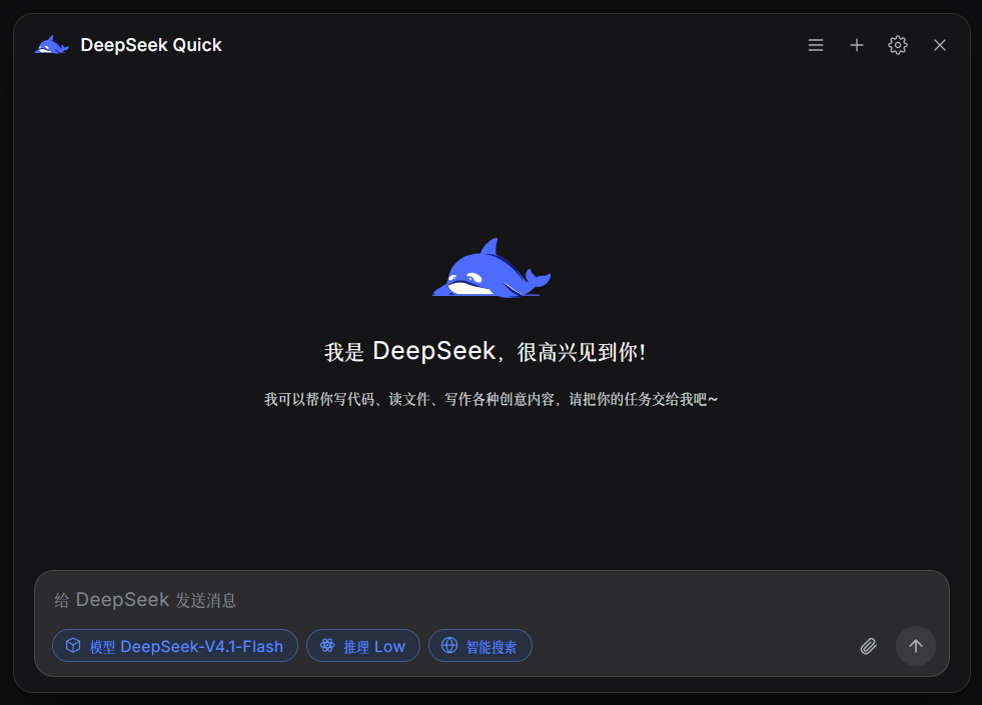
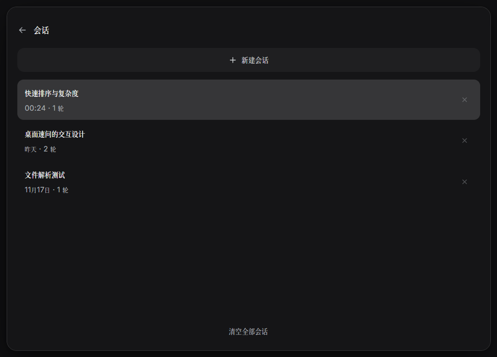

# DeepSeek Quick

**按下 `Alt + Space`，即可在 Windows 桌面快速唤出 DeepSeek。**

标题栏的图钉可以「窗口置顶」：置顶后点其他窗口不会自动隐藏，方便边看资料边问。



## 快速开始

**首次运行：** 在项目目录下打开终端，依次执行：

```bash
npm install
npm start
```

**后续运行：** 无需重复安装依赖，直接双击 `start.vbs` 即可启动。

首次启动时，填写 [DeepSeek API KEY](https://platform.deepseek.com/api_keys)。

### 对话界面


### 会话管理



## 安全说明

API KEY 明文保存在本地 `data/config.json`，请勿泄露或提交至公开仓库。
